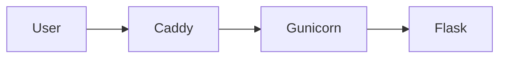

# NihonGo Dasar

Platform Belajar Bahasa Jepang Dasar

Cloud Computing — PTI 2802  
Pertemuan 3 — Project Inception

## Author
Iswan Herdiansah / NIM 2583207073011 / Kelas PTI 2A

## Problem
Pelajar pemula bahasa Jepang kesulitan menemukan materi dasar yang
terstruktur untuk belajar mandiri. NihonGo Dasar menyediakan materi dasar
bahasa Jepang dalam satu platform web.

## Target Users
- Pelajar pemula bahasa Jepang
- Pendidikan / Komunitas bahasa jepang dan LPK

## Features M03
- baseline application
- health endpoint
- VPS deployment

## Architecture

## Infrastructure
- IDCloudHost, Ubuntu Server 24.04
- 2 vCPU, 2 GB RAM, 20 GB disk
- Caddy, Gunicorn, systemd, UFW

## Public Endpoint
`http://103.193.177.44/`

## Health Check
`GET /health`

## Deployment
See `docs/deployment.md`.

## Security
- key-only SSH
- root SSH disabled
- UFW enabled
- backend loopback-only

## Current Limitations
- HTTP only
- no persistent database
- no container
- manual deployment

## Roadmap
M04 DNS/HTTPS, M05 Data, M06 Container, M07 IaC, M09 CI/CD
