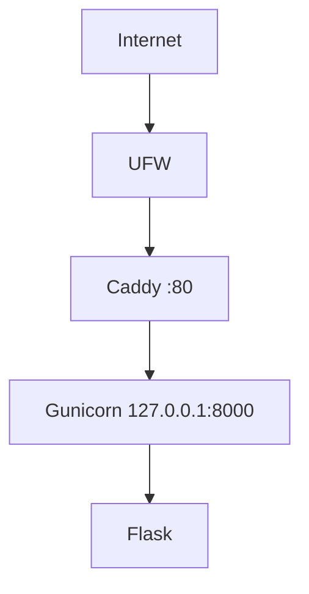

# Architecture v0.1

## Deployment View

## Resource Constraints
- Modul: 1 vCPU, 1 GB RAM, 20 GB disk
- Aktual: 2 vCPU, 2 GB RAM, 20 GB disk, swap 1 GB
- Gunicorn tetap 1 worker + 2 thread untuk menjaga headroom

## Security Decisions
- Administrasi memakai user non-root (cloudstudent)
- SSH key authentication (Ed25519)
- Password SSH dan root SSH dinonaktifkan
- UFW aktif: hanya port 22 dan 80
- Backend hanya listen di loopback

## Current Limitations
- HTTP only
- Single VPS
- Tidak ada database
- Tidak ada container
- Tidak ada CI/CD

## Planned Evolution
- M04 DNS + HTTPS
- M05 persistent data
- M06 container
- M07 IaC
- M09 CI/CD
